# DeepDeck

[](https://github.com/YesidAlmanzaGamba/DeepDeck.fw/actions/workflows/build.yml)
[](https://github.com/YesidAlmanzaGamba/DeepDeck.fw/releases/latest)

Firmware, configurator and desktop app for the **DeepDeck Ahuyama** macropad: 16 keys, 2 knobs, a
128x64 OLED and per-key RGB LEDs on an ESP32, connected to the computer over Bluetooth.

**[⬇ Download](https://github.com/YesidAlmanzaGamba/DeepDeck.fw/releases/latest)** ·
**[Install guide](docs/INSTALL.md)** · **[Tour of the app](#the-command-center-tour)** ·
**[What changed](#what-changed-from-the-original)** · **[Build it yourself](#building)**

This is a fork of the original DeepSea Developments projects, reworked as one repository so the
firmware, the protocol and the apps change together.

## The Command Center tour

The **DeepDeck Command Center** configures the DeepDeck over Bluetooth or the USB cable, on Windows,
macOS and Linux. Click a screen to jump to it.

<table>
  <tr>
    <td align="center"><a href="#dashboard">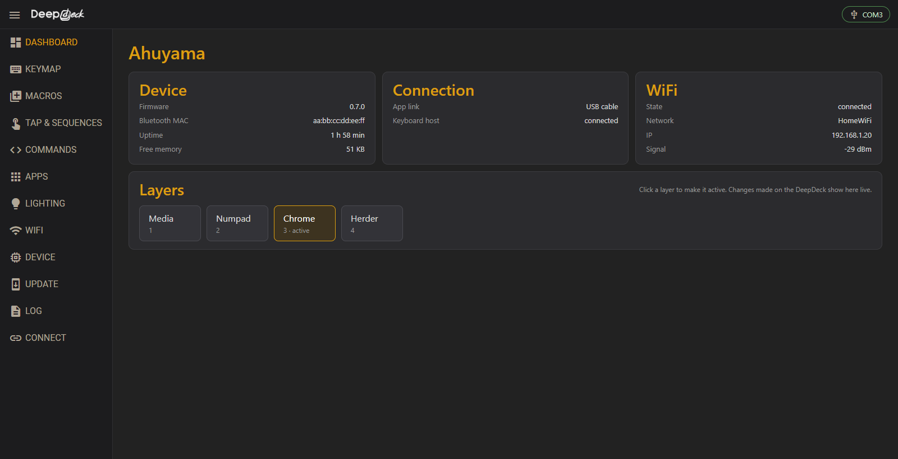<br><b>Dashboard</b></a></td>
    <td align="center"><a href="#keymap">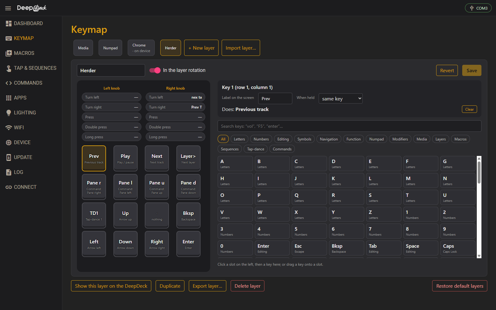<br><b>Keymap</b></a></td>
    <td align="center"><a href="#tap-dance-and-sequences">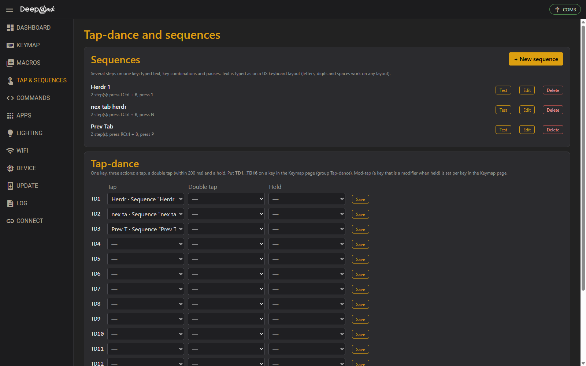<br><b>Tap &amp; sequences</b></a></td>
    <td align="center"><a href="#computer-commands-herdr-and-more">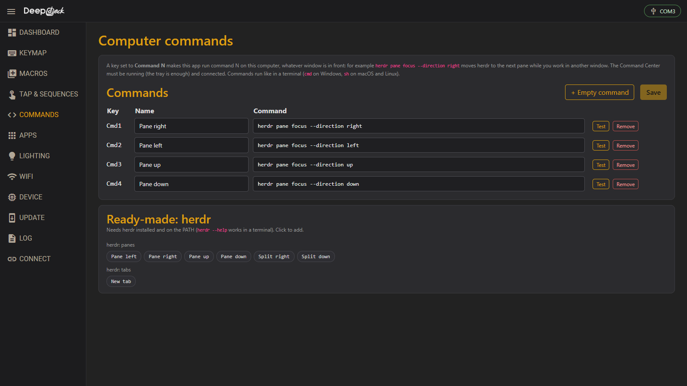<br><b>Commands</b></a></td>
  </tr>
  <tr>
    <td align="center"><a href="#layers-by-application">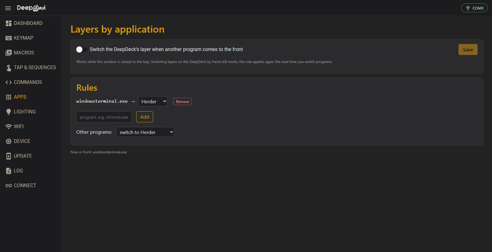<br><b>Apps</b></a></td>
    <td align="center"><a href="#lighting">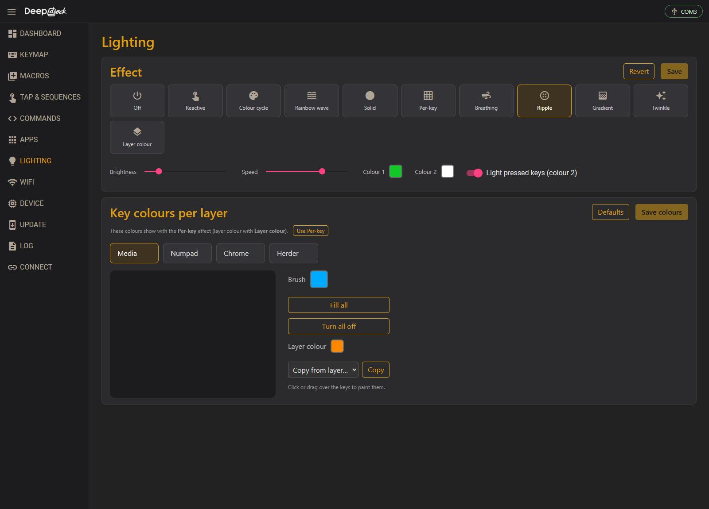<br><b>Lighting</b></a></td>
    <td align="center"><a href="#macros">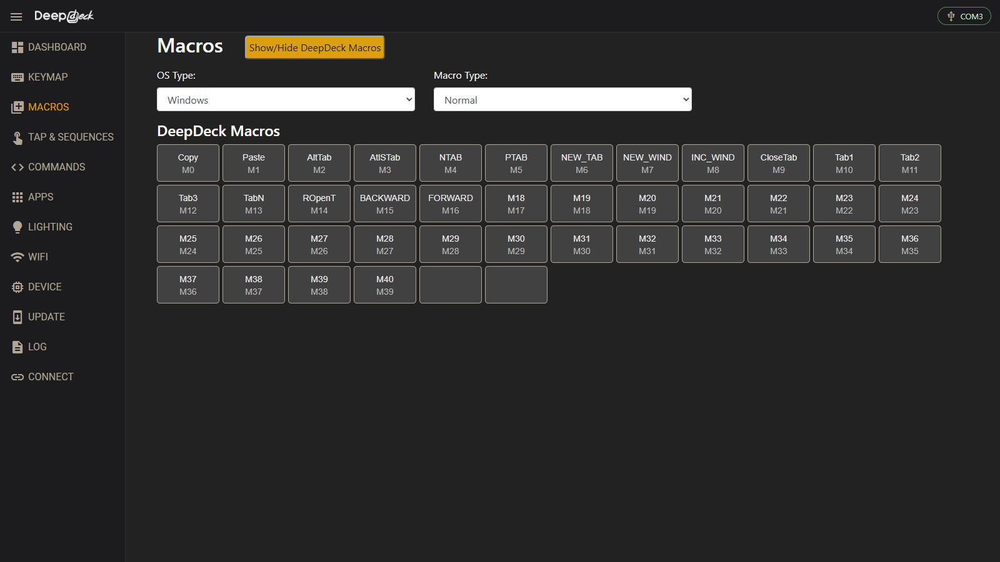<br><b>Macros</b></a></td>
    <td align="center"><a href="#firmware-update">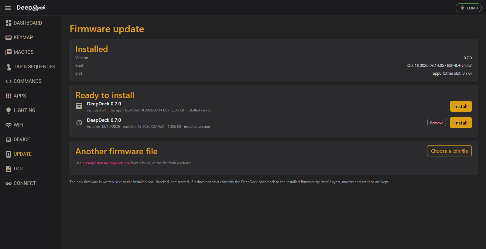<br><b>Update</b></a></td>
  </tr>
  <tr>
    <td align="center"><a href="#wifi">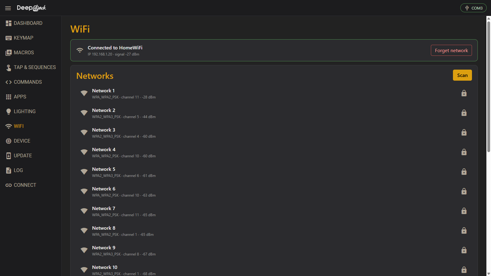<br><b>WiFi</b></a></td>
    <td align="center"><a href="#device">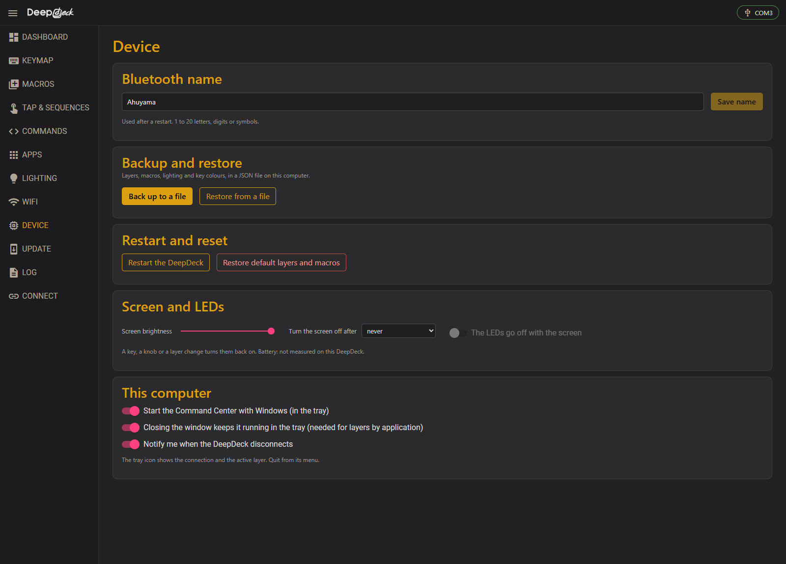<br><b>Device</b></a></td>
    <td align="center"><a href="#connect">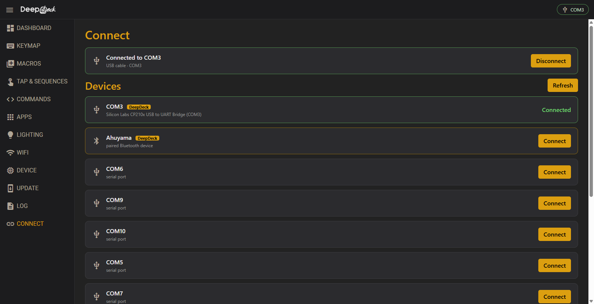<br><b>Connect</b></a></td>
    <td align="center"><a href="#log">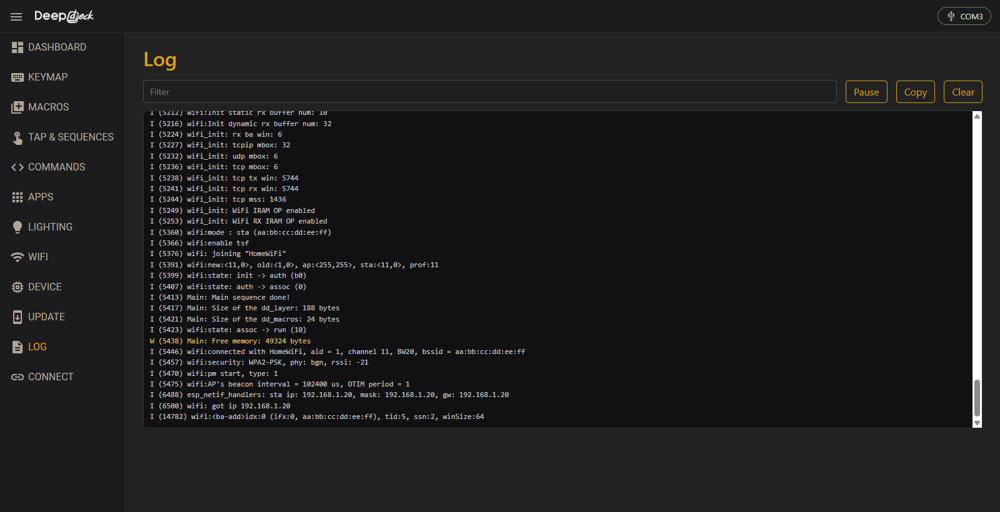<br><b>Log</b></a></td>
  </tr>
</table>

### Dashboard

<a href="docs/images/dashboard.png"></a>

The DeepDeck at a glance: firmware, memory, uptime, the link (Bluetooth or USB), WiFi. **Click a
layer to make it active**; when you change layers on the DeepDeck, the page follows live.

<details>
<summary><b>What happens on the DeepDeck</b></summary>

The OLED's yellow band shows the new layer's name and the 4x4 key names change at once; the LEDs
switch to that layer's colours.

<!-- VIDEO dashboard: paste the video link on the next line (docs/media/README.md) -->

</details>

### Keymap

<a href="docs/images/keymap.png"></a>

The 16 keys and both knobs (turn left/right, press, double press, long press), as on the device.

- **Click a slot, then a key** in the list, or **drag a key onto a slot**. Search: `vol`, `F5`, `enter`…
- Groups: letters, numbers, editing, symbols, navigation, F1–F24, numpad, modifiers, media,
  layers, your macros, sequences, tap-dances and computer commands.
- **When held → Ctrl/Shift/Alt/Win** turns a key into a *mod-tap*: tap = the key, hold = the modifier.
- The label (up to 6 characters) is what the OLED shows.
- **Export layer… / Import layer…** shares one layer as a file, with the macros, sequences,
  tap-dances and commands it uses.

<details>
<summary><b>What happens on the DeepDeck</b></summary>

After **Save** the layer is stored on the DeepDeck; **Show this layer on the DeepDeck** makes it
the active one so you can try it right away.

<!-- VIDEO keymap: paste the video link on the next line (docs/media/README.md) -->

</details>

### Tap-dance and sequences

<a href="docs/images/tap-and-sequences.png"></a>

- **Sequences:** several steps on one key: typed text, key combinations and pauses. **Test** types
  it into the window in front after 3 seconds.
- **Tap-dance:** one key, three actions: a tap, a double tap and a hold (`TD1`…`TD16` in the Keymap).

<details>
<summary><b>What happens on the DeepDeck</b></summary>

A sequence key types its steps one after the other, like a person would; a tap-dance key waits
200 ms to see whether a second tap comes.

<!-- VIDEO tap-and-sequences: paste the video link on the next line (docs/media/README.md) -->

</details>

### Computer commands (herdr and more)

<a href="docs/images/commands.png"></a>

A key set to **Command N** makes the app run command N on the computer, **whatever window is in
front**. Ready-made commands for [herdr](https://herdr.dev) move between panes, split them and open
tabs while you keep working in another window, for example `herdr pane focus --direction right`.
Any other command line works too. The app must be running (the tray is enough).

<details>
<summary><b>What happens on the DeepDeck</b></summary>

The key sends an event to the Command Center, which runs the command and lists the result under
*Recently run*.

<!-- VIDEO commands: paste the video link on the next line (docs/media/README.md) -->

</details>

### Layers by application

<a href="docs/images/apps.png"></a>

The DeepDeck switches layer when another program comes to the front (`chrome.exe` → *Chrome*,
your terminal → *Herder*…). Recently used programs can be added with one click. Windows for now.

<details>
<summary><b>What happens on the DeepDeck</b></summary>

Switch windows on the computer and the DeepDeck's screen and lights follow, within half a second.

<!-- VIDEO apps: paste the video link on the next line (docs/media/README.md) -->

</details>

### Lighting

<a href="docs/images/lighting.png"></a>

11 effects (reactive, colour cycle, rainbow wave, breathing, ripple, gradient, twinkle, per-key,
layer colour…), brightness, speed, two colours, and lighting pressed keys with any effect.
**Every change shows on the DeepDeck while you move the sliders**; Save keeps it. Below, **paint
the key colours of each layer**: click or drag over the keys, fill, copy from another layer.

<details>
<summary><b>What happens on the DeepDeck</b></summary>

The LEDs change live as you pick an effect or a colour; leaving the page without saving puts the
stored lighting back.

<!-- VIDEO lighting: paste the video link on the next line (docs/media/README.md) -->

</details>

### Macros

<a href="docs/images/macros.png"></a>

Key combinations pressed together (Ctrl+C, Alt+Tab…), usable on keys and knobs.

<!-- VIDEO macros: paste the video link on the next line (docs/media/README.md) -->

### Firmware update

<a href="docs/images/update.png"></a>

**Ready to install** lists the firmware that comes with the app and every firmware installed before
from this computer: one click, no files to look for. Under 3 minutes over the USB cable, about 11
over Bluetooth. If a new firmware does not start, the DeepDeck goes back to the previous one by
itself; layers and settings are kept.

<!-- VIDEO update: paste the video link on the next line (docs/media/README.md) -->

### WiFi

<a href="docs/images/wifi.png"></a>

Scan, pick a network, join (no restart; Bluetooth stays connected), forget.

### Device

<a href="docs/images/device.png"></a>

Bluetooth name, backup and restore of everything to a file, restart, default layers, **screen
brightness and screen off when idle** (the LEDs can go off with it), and for this computer: start
with Windows, keep running in the tray, notification when the DeepDeck disconnects.

### Connect

<a href="docs/images/connect.png"></a>

Paired DeepDecks (Bluetooth) and USB ports, the DeepDeck marked. The app reconnects by itself to
the last one; the chip in the top right corner always shows the link.

### Log

<a href="docs/images/log.png"></a>

The firmware's own log over the USB cable, with filter, pause and copy: handy when something does
not behave.

## Install

Follow the **[installation manual](docs/INSTALL.md)** (Windows, macOS, Linux). Installers come
from the [releases](https://github.com/YesidAlmanzaGamba/DeepDeck.fw/releases) or from every CI
run, and each one contains the newest firmware.

| | Windows | macOS | Linux |
|---|---|---|---|
| USB cable | ✅ | ✅ | ✅ |
| Bluetooth | ✅ tested | ✅ not tested yet | ✅ not tested yet |
| Layers by application, start with the computer | ✅ | later | later |

On macOS a DeepDeck connected to the Mac as a keyboard may not be found over Bluetooth (it stops
advertising); use the cable there.

## What changed from the original

<details>
<summary><b>Firmware and app changes (click to open)</b></summary>

- **Configure from a desktop app, not the WiFi portal.** Every setting is one method of a JSON
  protocol (`firmware/main/config_api.c`) over Bluetooth and the USB cable. The WiFi setup network
  and the web page on the device are gone (firmware 0.7.0), which freed 26 KB of RAM.
- **Firmware updates from the app**, with automatic rollback.
- **Lighting v2:** 11 effects, brightness, two colours, pressed keys, key colours per layer, live
  preview. The old per-key "Color" tab never worked, and the old rainbow effect flickered.
- **More from each key:** mod-tap, tap-dance, sequences (text, combinations, pauses), computer
  commands; knob macros use your macros.
- **New main screen:** the yellow band shows the layer name, its position, Bluetooth and WiFi
  icons; the 16 key names fill the rest as a 4x4 grid.
- **Settings menu** (press a knob): Device info (Bluetooth, WiFi, System), LED configuration, Restart.
- **The active layer is remembered** across restarts and sleep; layer-hold keys return to the
  previous layer.
- **Removed:** the APDS-9960 gesture sensor and mouse actions.
- **Bugs fixed on the way:** memory leaks, an out-of-bounds layer index, unchecked API input, the
  WiFi password in the log, lost USB bytes during flash writes, BLE lines over 512 bytes, and a
  firmware that did not link upstream.

Every change, with how it was verified, is in the [change log](docs/traceability/CHANGELOG.md);
every product decision is in the [decision log](docs/traceability/DECISIONS.md).

</details>

## Repository

| Folder | What it is | Built with |
|--------|------------|------------|
| [`firmware/`](firmware/README.md) | ESP32 firmware: keys, knobs, OLED, LEDs, BLE keyboard, configuration protocol | ESP-IDF **4.4.7** |
| [`web/`](web/README.md) | Angular screens of the Command Center | Node + Angular 15 |
| `web/src-tauri/` | **DeepDeck Command Center**, the desktop app (Tauri v2, Rust) | Rust + Tauri CLI |
| [`docs/protocol.md`](docs/protocol.md) | The configuration protocol (BLE and USB) | |
| `tools/cc-cli/` | Command-line protocol client and hardware self-test | Python |
| [`docs/plans/`](docs/plans/ROADMAP.md), [`docs/traceability/`](docs/traceability/CHANGELOG.md) | Roadmap, plans, change log and decision log | |

## Building

<details>
<summary><b>Firmware, desktop app, tests (click to open)</b></summary>

### Firmware

ESP-IDF **4.4.7** (5.x does not build this code).

```sh
idf.py -C firmware build
idf.py -C firmware -p COM3 flash monitor
```

ESP-IDF 4.4 breaks when a component *inside the project* has a `Kconfig` file and the project
path contains spaces. Keep project components free of `Kconfig` files (use `#ifndef` defaults
in the source instead) so the firmware builds from any folder.

### Desktop app

You need Node 22, Rust (stable), plus the MSVC Build Tools on Windows. From `web/`:

```sh
npm ci
npx --yes @tauri-apps/cli@2.12.3 dev     # development, with live reload
npx --yes @tauri-apps/cli@2.12.3 build   # release app and installer (bundles firmware/build/DeepDeck.bin)
```

### Testing with the device

```sh
python -I tools/cc-cli/cc_cli.py --usb COM3 --ble selftest     # protocol self-test, restores what it changes
DD_CC_SELFTEST=1 web/src-tauri/target/release/deepdeck-command-center.exe   # app link self-test
```

The self-test script needs `bleak` and `pyserial`.

### Automatic builds

Every push builds the firmware and the installers for Windows, macOS and Linux on GitHub Actions
(`.github/workflows/build.yml`); the files are under the run's *Artifacts*. A tag like `v0.7.0`
creates a release with all of them.

</details>

## History

`firmware/` comes from [DeepDeck.Ahuyama.fw](https://github.com/DeepSea-Developments/DeepDeck.Ahuyama.fw)
and `web/` from the `develop` branch of
[DeepDeck.Web](https://github.com/DeepSea-Developments/DeepDeck.Web), imported with `git subtree`
so both histories are preserved.
